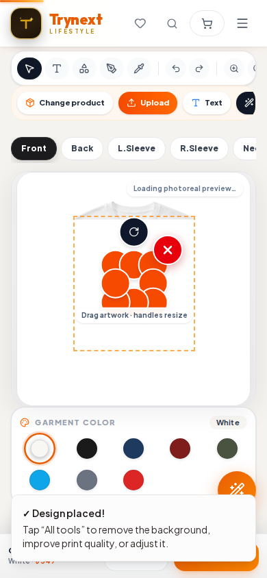
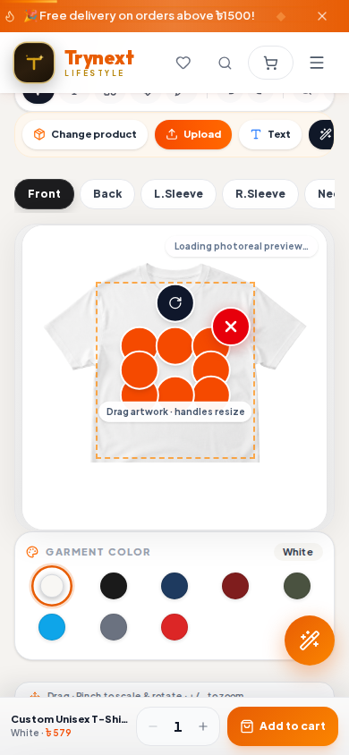
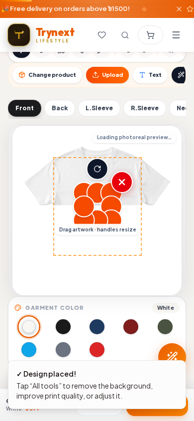
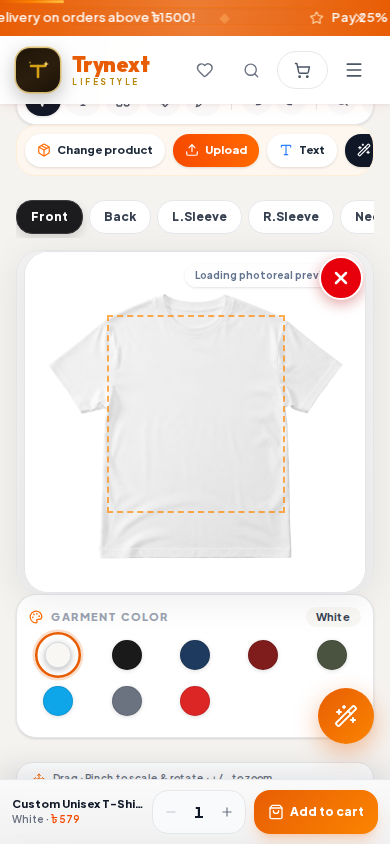

# M5b — PR #67 mobile preview retest

**Run:** 2026-10-12, approximately 04:47–04:49 +06:00

**Preview:** [PR #67 Design Studio](https://claude-awesome-goldberg-u7c4.trynext-shop-new.pages.dev/design-studio)

**PR:** [#67 — one handle gesture follows one pointer](https://github.com/georgelsmith333-hub/New-Trynext/pull/67), head `9b810083a48264c7d70ec233754808bbd9beeaca`; open, draft, not merged/deployed. Four GitHub checks were green at 04:49 +06:00.

## Test method and safety

Used fresh, isolated Playwright Chromium contexts at 390×844, DPR 1, touch enabled, and the same disposable 64×64 local PNG used for M5b. No physical phone was used. Playwright blocked every non-read HTTP request; the only blocked POSTs observed were analytics collection. The Studio draft `localStorage.setItem` was intercepted in memory. No cart, checkout, application storage upload, order, customer data, provider setting, or production state was touched. No page errors were observed.

## Results

| Case | Verified input | Before | After | Result |
|---|---|---|---|---|
| Two pointers on real west/east resize buttons | Located the actual `Scale artwork from w/e` buttons from their DOM rectangles; started at their centers `(169,414)` and `(223,414)`, then moved outward. | `scale=2.5, scaleX=1, scaleY=1, rotation=0°` | `scale=2.5, scaleX=1.468415, scaleY=1, rotation=0°` | The west/first pointer remained the owner; the second pointer was ignored. The prior collapse to `scaleX=0.15` did not recur. This is one-axis handle resizing, not a two-finger pinch, and confirms the pointer-owner guard in this path. |
| Two pointers starting off all resize buttons | Measured the clear center gap between the eight 44×44px buttons: only `10.719×10.718px`. Both starts were in the gap at `(192.14,413.94)` and `(199.86,413.94)`; `elementFromPoint` returned `CANVAS` for both. Start separation was 7.72px. | `scale=2.5, scaleX=1, scaleY=1, rotation=0°` | `scale=scaleX=scaleY=6.516058, rotation=11.466294°, x=32.163743, y=11.695906` | The Stage pinch path did respond to a true off-handle start and changed both axes uniformly while rotating. The final state exactly matched the **first** move. The second move should have reached the scale clamp of 8 and rotation `15.0657°`, but the final state did not change; continued updates remain unverified/defective or event-harness-sensitive. The cause is not established. |

## Important correction and remaining concern

An earlier provisional attempt labeled “inside artwork/off handles” used `(170,420)` and `(245,420)`. After measuring the live DOM rectangles, both points were inside the west/east 44px button hit areas; that attempt is **not** evidence of a true off-handle pinch. A separate stage-margin attempt cleared the selection and is also not a valid pinch. The table above reports the corrected, verified test paths only.

At this small rendered artwork size, the 44px controls overlap nearly all of the image selection area, leaving just a roughly 10.7px square canvas opening. A practical two-finger gesture cannot comfortably start there without touching a handle. The true-gap test also stopped reflecting movement after its first move. These are follow-up issues for Claude to investigate; do not declare M5 complete based on the handle-owner regression alone.

## Evidence screenshots

**Actual resize-button test**

**True off-handle center-gap test**

## Exact next action for Claude

Keep PR #67 open and draft; do not merge or deploy without the owner’s per-PR approval. Read these results and add/extend focused regression coverage for (1) two pointers starting on separate scale buttons, proving the first pointer owns only its intended resize and the second cannot steer it; and (2) a multi-move pinch/rotate starting outside all handles, proving both axes and rotation update through the full gesture after state rerenders. Investigate why the 44px hit targets leave only a 10.7px off-handle gap on the small mobile preview and why the second move was not reflected. Preserve existing resize, auto-fit, upload, and rendering behavior; report test results, any code/PR changes, and remaining limitations in `claude/reports.md`. Keep M5 **PARTIAL** until the full gesture behavior is resolved and verified. M1 remains owner-only; do not run M2 without an explicit `M1 done` signal.
