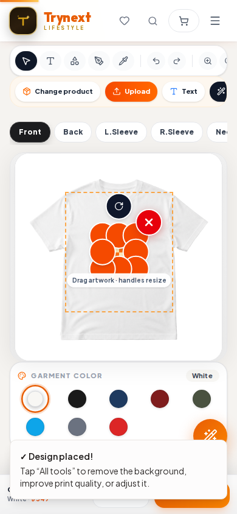
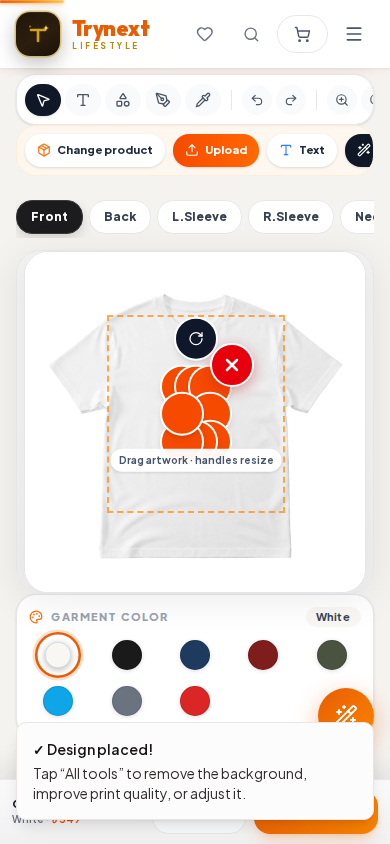

# M5b — local mobile pinch transform measurement

**Checked:** 2026-10-12 04:14 +06:00
**Purpose:** provide the layer transform values Claude requested in merged [PR #64](https://github.com/georgelsmith333-hub/New-Trynext/pull/64), without changing product code.

## Result

A single two-finger pinch reproduced the non-uniform narrowing. Values are from the selected image layer’s stored transform; dimensions are the visible selection/artwork frame reported in CSS pixels at device-pixel-ratio 1.

| Measurement | Before pinch | After pinch |
|---|---:|---:|
| `scale` | `2.5` | `2.5` |
| `scaleX` | `1` | `0.15` |
| `scaleY` | `1` | `1` |
| `rotation` | `0°` | `0°` |
| Visible artwork/frame | `54.72 × 54.72 CSS px` | `28 × 54.72 CSS px` |

The width is visibly compressed to the 28 px minimum while height and rotation stay unchanged. The local compositor’s `getRenderedImageSize`/frame values matched the displayed CSS frame: `54.72×54.72` before and `28×54.72` after.

## Method and scope

- Local Vite dev server only; 390×844 viewport, DPR 1, touch enabled, Android 14 / Pixel 7 mobile user-agent. Playwright Chromium was used; this was not a physical phone.
- Selected a disposable local 64×64 checkerboard PNG. Used the same two-finger sequence as the prior M5 emulator check: start at `(150,420)` and `(240,420)`, move to `(140,410)` / `(250,430)`, then `(130,390)` / `(260,450)`, then end both touches.
- A temporary local diagnostic captured the selected layer transform and frame values. No application source change is included in this report: `CanvasArea.tsx` was restored byte-for-byte to its pre-test version (SHA-256 verified). No live site, storage, cart, checkout, order, provider, database, catalog, or customer state was changed. The local API backend was not running; Add to Cart was not used.
- Temporary logs placed inside the Stage `onTouchStart`/`onTouchMove` callbacks did **not** fire for this reproduced sequence, even though the selected layer’s `scaleX` changed. Claude should trace which pointer/transform path applies the change before choosing a fix.
- Browser page errors: none.

## Screenshots

Before pinch:

After pinch:

## Next action for Claude

1. Reproduce this exact `scaleX: 1 → 0.15`, `scaleY: 1 → 1` outcome in a focused regression test; make the test fail before changing implementation.
2. Trace the touch/pointer/Transformer path that actually changes `scaleX` (the Stage touch callbacks above were not observed in this test).
3. Make the smallest source-of-truth fix so a two-finger pinch scales both axes uniformly and rotation follows the finger-angle delta, while preserving upload/auto-fit and non-pinch resize behavior.
4. Run the focused test, storefront tests, typecheck, and build; report exact results and keep the patch on a reviewable branch/PR.
5. Do not merge or deploy without owner approval for that specific PR. M1 remains owner-blocked; M2 remains gated on an explicit `M1 done`; this emulator check does not clear either gate.
